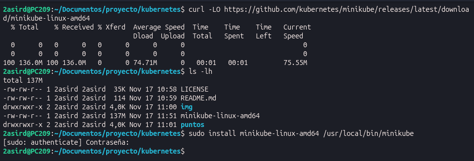
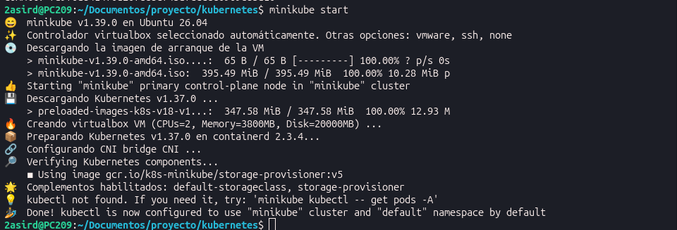
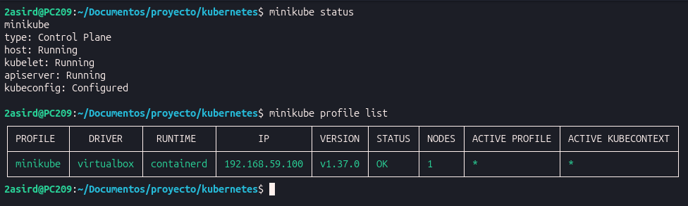
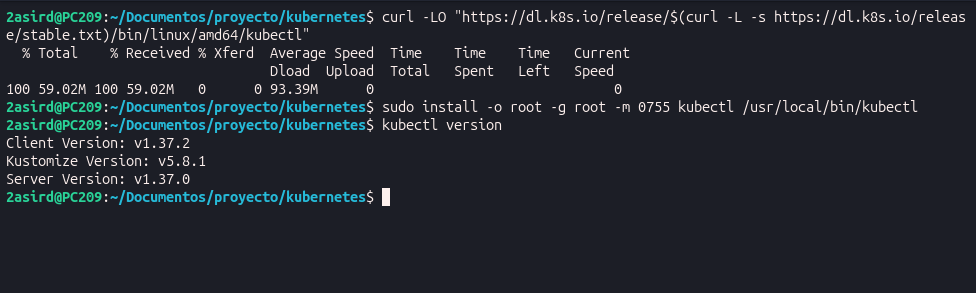
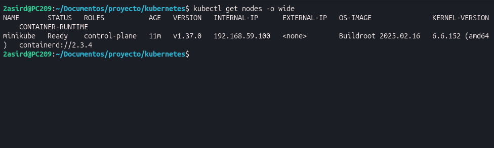
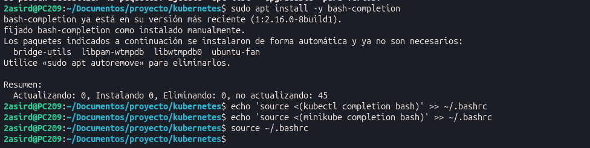
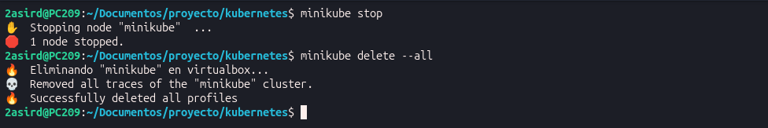
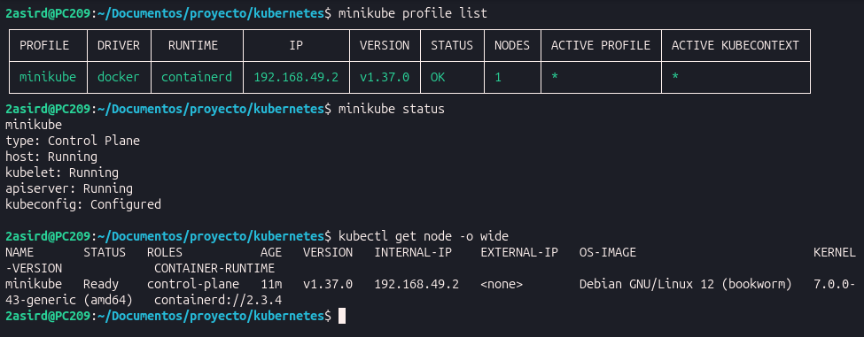
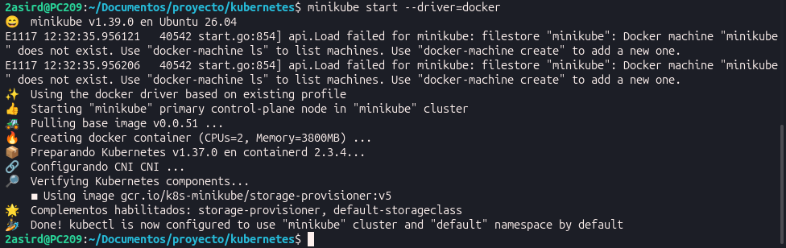

# 2. Instalación de Minikube sobre Ubuntu y VirtualBox / Docker

Documentación oficial de referencia:

- [Página oficial para la instalación de Minikube](https://minikube.sigs.k8s.io/docs/start/?arch=%2Flinux%2Fx86-64%2Fstable%2Fbinary+download)
- [Página oficial para la instalación de kubectl](https://kubernetes.io/docs/tasks/tools/install-kubectl-linux/)

## 2.1 Instalación de Minikube

Descarga del binario de Minikube e instalación en `/usr/local/bin/minikube` con los permisos necesarios:

```bash
curl -LO https://github.com/kubernetes/minikube/releases/latest/download/minikube-linux-amd64
sudo install minikube-linux-amd64 /usr/local/bin/minikube
```



### Arranque y comprobación de estado

- **Crear el entorno de Minikube** usando el controlador predeterminado (en este caso, VirtualBox):

```bash
minikube start
```

- **Crear el entorno especificando el controlador**:

```bash
minikube start --driver=virtualbox
```



- **Consultar el estado y los perfiles disponibles**:

```bash
minikube status
minikube profile list
```



## 2.2 Instalación de kubectl

- **Descargar el binario de `kubectl`** (última versión estable):

```bash
curl -LO "https://dl.k8s.io/release/$(curl -L -s https://dl.k8s.io/release/stable.txt)/bin/linux/amd64/kubectl"
```

- **Instalar `kubectl`** en `/usr/local/bin/kubectl`:

```bash
sudo install -o root -g root -m 0755 kubectl /usr/local/bin/kubectl
```



- **Comprobar la versión e información de los nodos**:

```bash
kubectl version
kubectl get nodes -o wide
```



## 2.3 Activación del autocompletado de comandos

Para habilitar el autocompletado en `bash` tanto para `kubectl` como para `minikube`:

1. **Instalar el paquete `bash-completion`**:

```bash
sudo apt install -y bash-completion
```

2. **Añadir las órdenes de autocompletado al archivo `~/.bashrc` del usuario**:

```bash
echo 'source <(kubectl completion bash)' >> ~/.bashrc
echo 'source <(minikube completion bash)' >> ~/.bashrc
```

3. **Recargar la configuración de `~/.bashrc`**:

```bash
source ~/.bashrc
```



## 2.4 Eliminación

- **Detener el clúster de Minikube**:

```bash
minikube stop
```

- **Eliminar todas las máquinas y perfiles creados de Minikube**:

```bash
minikube delete --all
```



## 2.5 Instalación de Kubernetes sobre Docker

Para ejecutar Minikube utilizando Docker como controlador en lugar de VirtualBox:

1. **Comprobar la versión y el estado del servicio Docker**:

```bash
docker version
systemctl status docker
```

2. **Añadir el usuario actual al grupo `docker`** e instalar `util-linux-extra` para disponer del comando `newgrp`:

```bash
sudo usermod -aG docker $USER
sudo apt install util-linux-extra
```

3. **Aplicar el cambio de grupo principal sin cerrar sesión**:

```bash
newgrp docker
```



4. **Iniciar Minikube con el driver de Docker**:

```bash
minikube start --driver=docker
```


