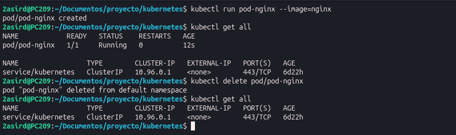
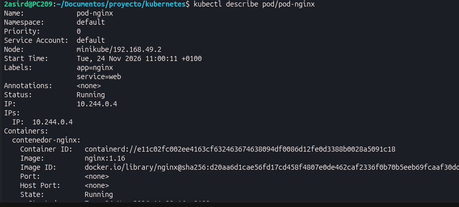
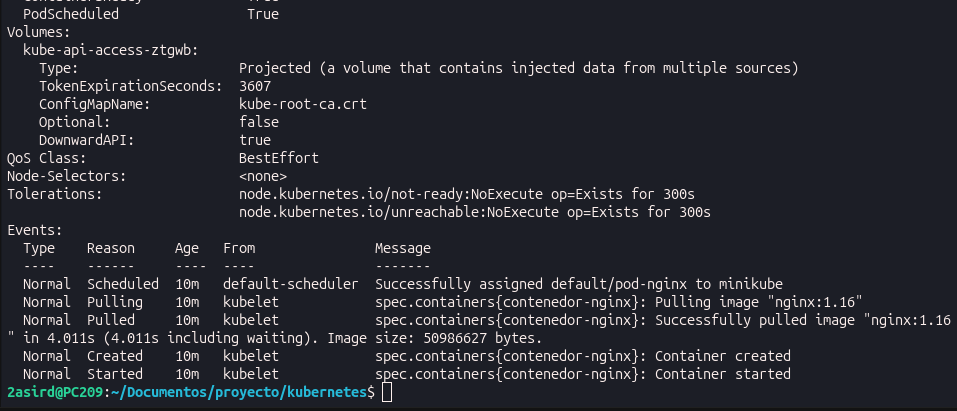
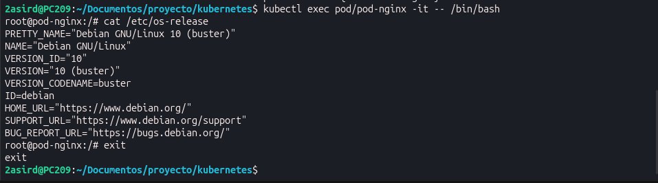
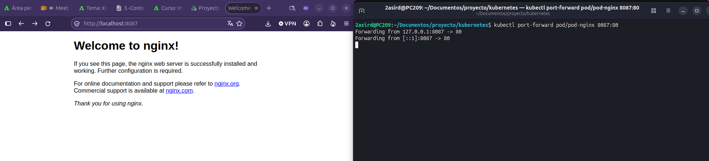
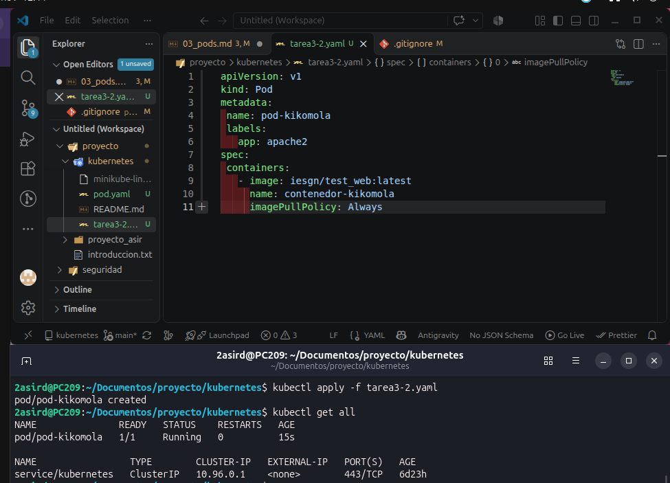
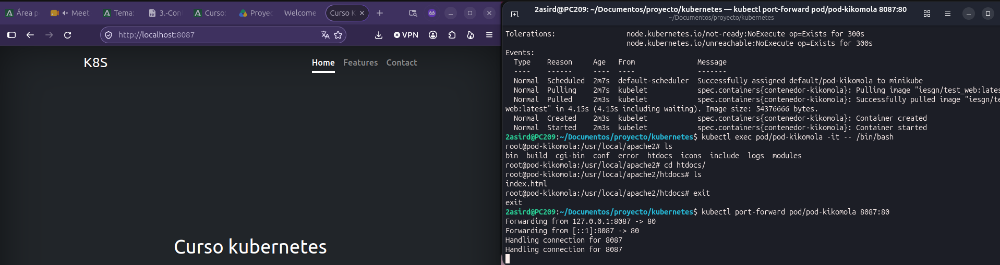
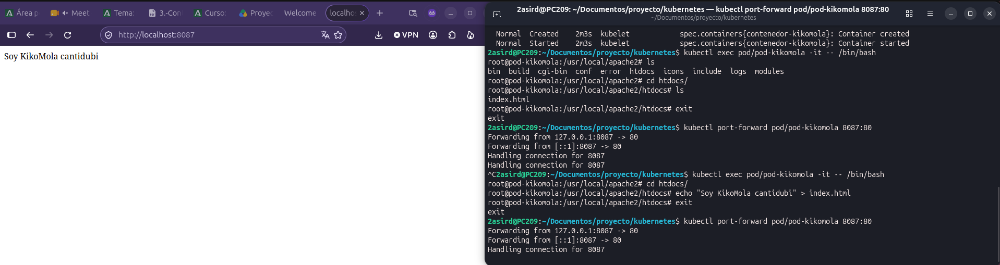
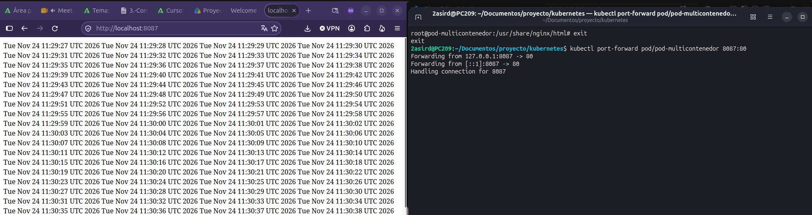

# 3. Pods

Un **Pod** es la unidad mínima de ejecución en Kubernetes y agrupa uno o varios contenedores que comparten red y almacenamiento.

## 3.1 Creación y gestión de Pods de forma imperativa

Puedes crear, inspeccionar y eliminar Pods directamente desde la línea de comandos con `kubectl`:

```bash
kubectl run pod-nginx --image=nginx
kubectl get pods
kubectl delete pod/pod-nginx
```

| Comando | Descripción |
| --- | --- |
| `kubectl run pod-nginx --image=nginx` | Crea un Pod llamado `pod-nginx` a partir de la imagen `nginx`. |
| `kubectl delete pod/pod-nginx` | Elimina el Pod `pod-nginx`. |
| `kubectl apply -f ../ficheros/pod.yaml` | Crea o actualiza recursos definidos en un manifiesto YAML. |



### Inspección y depuración de un Pod

Para consultar los detalles, eventos, logs y estado de un Pod:

```bash
kubectl describe pod/pod-nginx
kubectl logs pod/pod-nginx
```

| Comando | Descripción |
| --- | --- |
| `kubectl describe pod/pod-nginx` | Muestra la configuración completa, estado y eventos del Pod. |
| `kubectl logs pod/pod-nginx` | Muestra la salida estándar (logs) del contenedor del Pod. |





### Acceso interactivo y redirección de puertos

Para abrir una sesión interactiva dentro del contenedor o redirigir un puerto local hacia el Pod:

```bash
kubectl exec pod/pod-nginx -it -- /bin/bash
cat /etc/os-release
```



```bash
kubectl port-forward pod/pod-nginx 8087:80
```

| Comando | Descripción |
| --- | --- |
| `kubectl exec pod/pod-nginx -it -- /bin/bash` | Abre una terminal interactiva dentro del Pod `pod-nginx`. |
| `kubectl port-forward pod/pod-nginx 8087:80` | Redirige el puerto local `8087` al puerto `80` del Pod. |



## 3.2 Trabajando con Pods mediante manifiestos YAML

Además de la creación imperativa, los Pods se definen de forma declarativa en ficheros YAML como [pod.yaml](../ficheros/pod.yaml) o [tarea3-2.yaml](../ficheros/tarea3-2.yaml).

Ejemplo de manifiesto ([tarea3-2.yaml](../ficheros/tarea3-2.yaml)):

```yaml
apiVersion: v1
kind: Pod
metadata:
 name: pod-kikomola
 labels:
   app: apache2
spec:
 containers:
   - image: iesgn/test_web:latest
     name: contenedor-kikomola
     imagePullPolicy: Always
```

Para aplicar el manifiesto y comprobar el funcionamiento del Pod:

```bash
kubectl apply -f ../ficheros/tarea3-2.yaml
kubectl get pods
kubectl describe pod/pod-kikomola
```







## 3.3 Trabajando con un Pod multicontenedor

Un Pod puede ejecutar varios contenedores que comparten un volumen común (`emptyDir`), como se define en [pod_multicontenedor.yaml](../ficheros/pod_multicontenedor.yaml) y [tarea3-3.yaml](../ficheros/tarea3-3.yaml):

```yaml
apiVersion: v1
kind: Pod
metadata:
  name: pod-multicontenedor
spec:
  volumes:
  - name: html
    emptyDir: {}
  containers:
  - name: contenedor1
    image: nginx
    volumeMounts:
    - name: html
      mountPath: /usr/share/nginx/html
  - name: contenedor2
    image: debian
    volumeMounts:
    - name: html
      mountPath: /html
    command: ["/bin/sh", "-c"]
    args:
      - while true; do
          date >> /html/index.html;
          sleep 1;
        done
```

Para desplegarlo y acceder a un contenedor concreto con `-c`:

```bash
kubectl apply -f ../ficheros/pod_multicontenedor.yaml
kubectl exec pod/pod-multicontenedor -c contenedor1 -it -- /bin/bash
```

| Dato | Descripción |
| --- | --- |
| `contenedor1` | Servidor web `nginx` que sirve el contenido de `/usr/share/nginx/html`. |
| `contenedor2` | Contenedor `debian` que escribe la fecha cada segundo en `/html/index.html`. |
| `-c contenedor1` | Especifica el contenedor al que conectarse dentro del Pod multicontenedor. |



## Resumen de comandos

```bash
kubectl run pod-nginx --image=nginx
kubectl apply -f ../ficheros/pod.yaml
kubectl get pods
kubectl describe pod/pod-nginx
kubectl logs pod/pod-nginx
kubectl exec pod/pod-nginx -it -- /bin/bash
kubectl port-forward pod/pod-nginx 8087:80
kubectl exec pod/pod-multicontenedor -c contenedor1 -it -- /bin/bash
kubectl delete pod/pod-nginx
```
